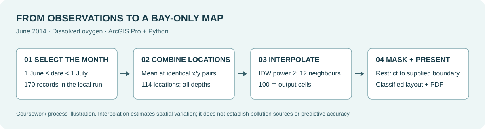

# Corozal Water Quality
### From June observations to a bay-only dissolved-oxygen map

**Python · ArcGIS Pro · spatial interpolation · water quality · cartography**

This University of Belize GIS coursework project explores how dissolved-oxygen observations can be filtered, combined at repeated sampling locations, and interpolated into a continuous map. The task was to isolate June 2014 and show the estimated values within the bay boundary supplied with the `Corozal_WaterQuality` project.

The completed local project contains an ArcGIS Pro map, a PDF layout, a raster surface, and an ArcGIS Online viewing copy. This repository shares the processing code and methods behind those outputs. The supplied datasets and data-bearing project files remain outside the public repository.



## What the workflow does

| Question | GIS approach | Important limit |
|---|---|---|
| Which records belong to June 2014? | Filter `SampleDate` from 1 June inclusive to 1 July exclusive | This includes the whole month, rather than the summer-date task bundled with the source project |
| How are repeated locations handled? | Average valid dissolved-oxygen values at each identical projected coordinate pair | This is a mean of the supplied records, not a time-weighted or depth-standardized mean |
| How are values estimated between stations? | Inverse distance weighting, power 2, using the 12 nearest locations | Nearby observations receive more weight; no independent accuracy assessment was performed |
| How is the output restricted to the bay? | Apply the supplied polygon as the raster mask | The boundary comes from the teaching data, not a newly surveyed shoreline |
| How are the results presented? | Classified map, sampling locations, legend, north arrow, scale bar, author and source note | The 100 m cell size is an output setting, not a statement of measurement accuracy |

## Results from the completed coursework run

| Measure | Result |
|---|---:|
| June records | 170 |
| Unique sampling locations | 114 |
| Output cell size | 100 m |
| IDW power | 2 |
| Nearest locations | 12 |
| Original interpolated raster range | approximately 2.663–9.812 mg/L |

All sampled depths were included. The original display used five classes: **2–4, 4–5, 5–6, 6–7 and 7–10 mg/L**. These are cartographic classes, not regulatory water-quality categories.

The figures above describe the saved coursework run. The public scripts are a reorganized reproduction workflow, tested locally against the authorized inputs; they do not download the teaching dataset. Unit tests use invented records only. See the [release validation](docs/release_validation.md) and [methods](docs/methods.md) for what was checked.

## Read the result in context

The supplied project uses the Corozal/Chetumal Bay name, but its retained processing metadata also refers to an earlier **Chesapeake Water Quality** package. The bay metadata includes descriptions of other source products. That mixed provenance has not been independently resolved. This portfolio presents a GIS teaching exercise under its supplied project name; it does not establish the observations as verified Corozal Bay field monitoring.

The analysis does not identify pollution sources, diagnose ecosystem health, or estimate uncertainty. Pooling observations across dates and depths can hide important variation. More sampling, consistent depth selection, and validation against withheld observations would be needed before treating this surface as a monitoring product.

## Run the workflow with authorized local data

Requires **ArcGIS Pro 3.7**, a licensed ArcPy environment, and **Spatial Analyst**. ArcPy is installed with ArcGIS Pro; it is not a dependency to install with ordinary `pip`.

Place your authorized `DissolvedO2.shp` and `Bay.shp` files, including their sidecar files, in a local folder. Supply a local ArcGIS Pro `.aprx` template, such as the extracted coursework project or a blank Map project you create in Pro. From ArcGIS Pro's Python Command Prompt, run:

```powershell
python scripts/build_water_quality.py --input-folder "D:/GIS/WaterQuality" --template-project "D:/GIS/Templates/Map.aprx" --output-folder "D:/GIS/June2014" --author "Kyle Ali"
```

The output directory must be new or empty. The template is read and saved as a separate project. The script creates a geodatabase, June records, station means, a bay-masked raster, an ArcGIS Pro project, a PDF, a PNG and a validation summary. It does not publish anything to ArcGIS Online or GitHub.

The small data-preparation checks run without ArcGIS:

```powershell
python -m unittest discover -s tests -v
```

## Repository guide

```text
scripts/   monthly filtering, station aggregation, ArcPy interpolation and layout
docs/      methods, data provenance and local archive inventory
figures/   workflow illustration without supplied geographic data
tests/     synthetic date-boundary, invalid-value and repeat-location checks
```

The original `.aprx`, `.ppkx`, geodatabase, map images and PDF are preserved locally. Their selected filenames and hashes are recorded in the [local archive inventory](docs/local_archive_inventory.json). See [data sources and reuse](docs/data_sources.md) for why they are not distributed here.

## Author

**Kyle Ali** · Marine biology student, University of Belize

This project demonstrates monthly data selection, spatial-reference management, repeated-location aggregation, IDW interpolation and map-layout production. It is separate from [Following the Water](https://github.com/kylealibz/following-the-water), the Belize River environmental-evidence portfolio. It is a personal coursework portfolio and does not imply institutional endorsement.

Original repository code and documentation are MIT licensed. That licence does not grant rights to the excluded teaching data or to Esri software.
